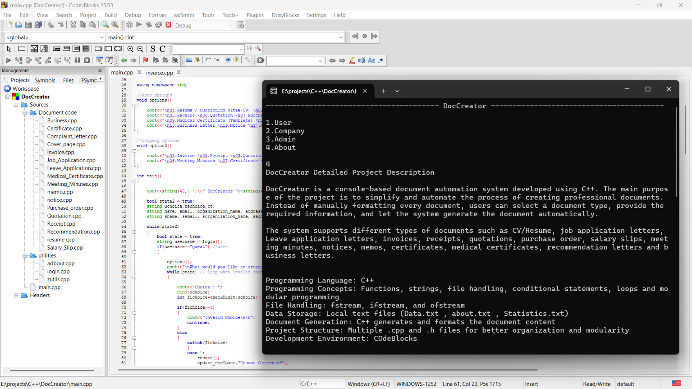
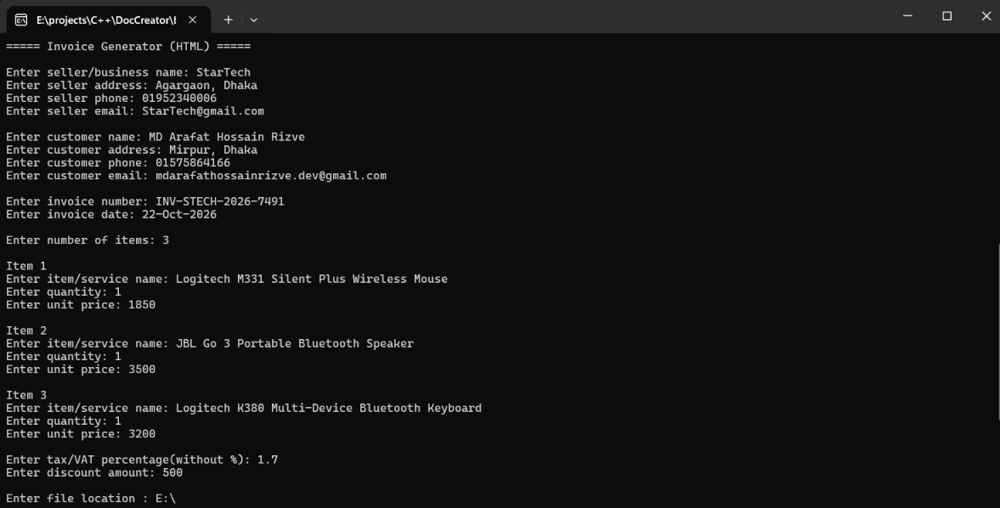
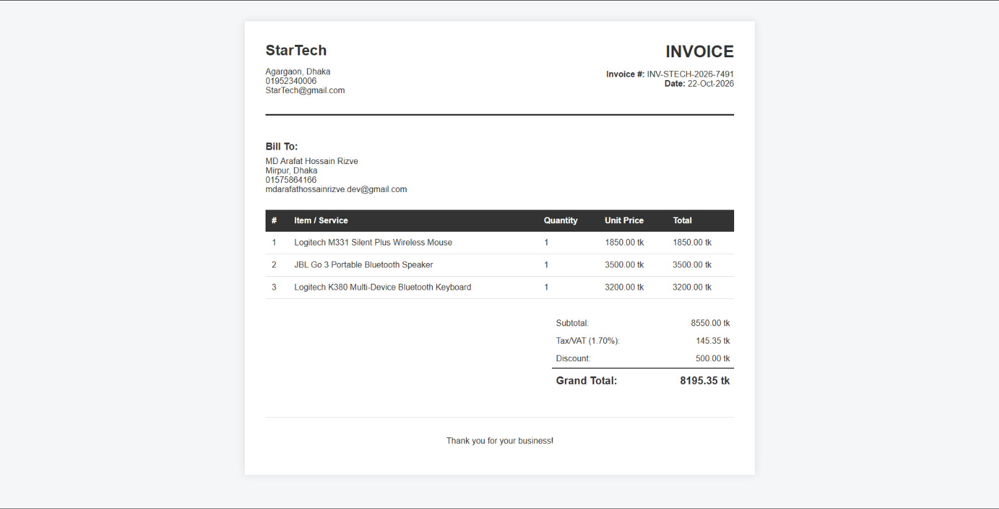

# DocCreator
### C++ Console-Based Document Automation System

DocCreator is a C++ application designed to simplify document creation through a menu-driven console interface. It collects user input and generates HTML documents for personal, academic, and business purposes.
The project demonstrates practical C++ programming, file handling, modular code organization, and automated HTML generation.

## Features
**Multiple Document Templates** — Create resumes, job application letters, leave applications, invoices, receipts, quotations, purchase orders, salary slips, certificates, notices, memos, and other supported documents.
**User Registration and Login** — Access the application's document-generation features through a basic authentication system.
**HTML Document Generation** — Convert entered information into formatted HTML files that can be opened in a web browser.
**Business Document Automation** — Generate invoices, receipts, quotations, and other business-related documents.
**File-Based Data Storage** — Use local text files to store application data and maintain basic system statistics.
**Administrative Functions** — Support user management and basic application statistics.

## Technologies Used
- **Language:** C++
- **File Handling:** C++ file streams (`fstream`)
- **Document Output:** HTML
- **Development Environment:** Code::Blocks
- **Compiler:** MinGW

## Screenshots





## Getting Started

### Requirements
- Windows
- Code::Blocks with a compatible MinGW compiler, if building from source

### Build from Source
1. Clone the repository:

   ```bash
   git clone https://github.com/mdArafat-hossain/DocCreator.git
   ```

2. Open the project file `DocCreator.cbp` in Code::Blocks, if it is included in the repository.
3. Configure the compiler and build the project.
4. Run the compiled application.

## How to Use
1. Launch DocCreator.
2. Register an account or log in, where required.
3. Choose a document type from the console menu.
4. Enter the requested information.
5. Generate the document.
6. Open the generated HTML file in your browser.

## Project Structure

```text
DocCreator/
├── Document code/
│   └── Document-generation source files
├── utilities/
│   └── Supporting source files
├──photes
├──data.txt
├──statistics.txt
├── main.cpp
├── DocCreator.cbp
├──.gitignore
└── README.md
```

## Future Improvements
- Improve password protection and account security.
- Strengthen input validation and error handling.
- Add more document templates and customization options.
- Improve the styling of generated documents.
- Introduce database-backed storage.
- Add multiple Language opions
- Develop a graphical user interface (GUI) to improve user experience.

## Author
**Arafat Hossain Rizve**
- GitHub: [mdArafat-hossain](https://github.com/mdArafat-hossain)
